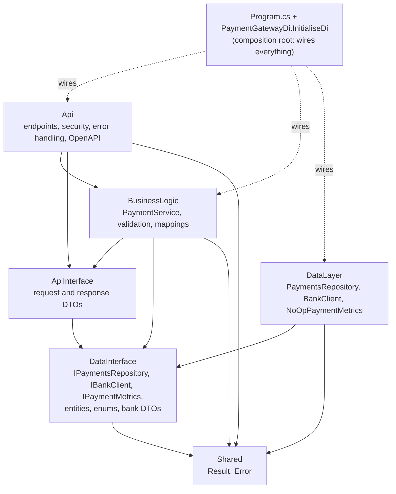
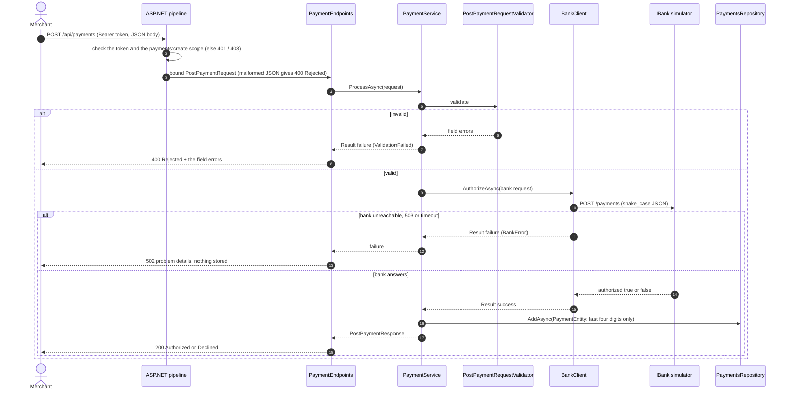
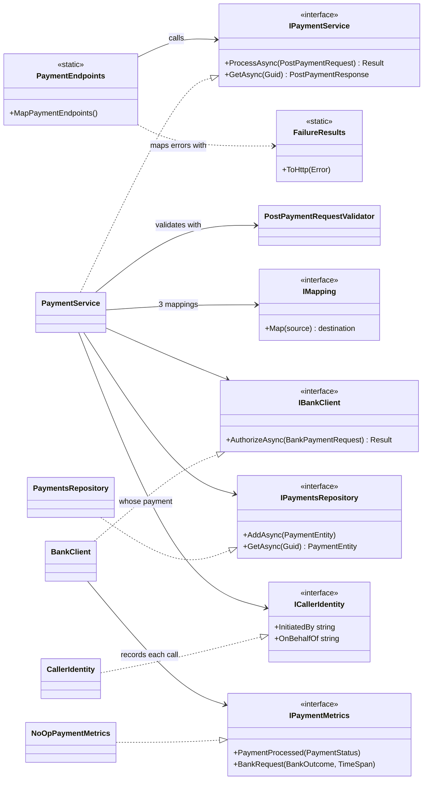
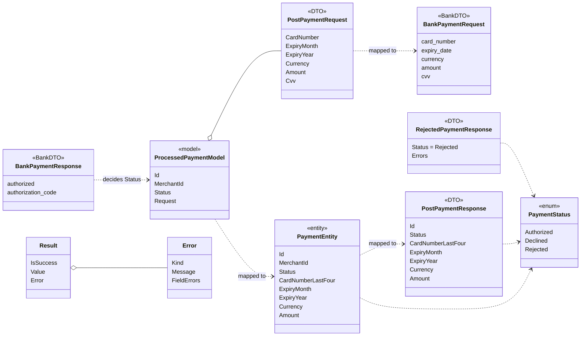
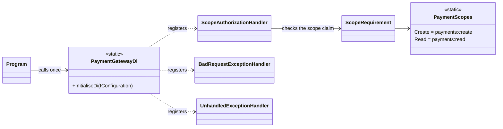

# How it works

A short tour of the software: what it does, how a request moves through it, and how the classes fit
together. The diagrams are [Mermaid](https://mermaid.js.org/), which GitHub renders. For the reasoning behind each
decision see [`architecture-decisions.md`](architecture-decisions.md). A standalone copy that opens in any browser (no GitHub needed) is `how-it-works.html` in this folder, generated from this file by `scripts/build-how-it-works-html.ps1`.

## In one paragraph

A merchant sends `POST /api/payments` with card details. The gateway checks the caller's token, validates the request
against the brief's rules, forwards a valid one to the acquiring bank (a simulator), stores the outcome and answers
`Authorized` or `Declined`. Anything invalid is answered `Rejected` (400) without calling the bank or storing anything. A
bank that cannot answer is an error to the merchant (502), not a decline. `GET /api/payments/{id}` returns a stored
payment to the merchant that owns it (any other merchant gets 404). The full card number and the CVV go to the bank and
nowhere else: what is stored, returned and logged holds only the last four digits.

## The layers

Dependencies point one way; architecture tests enforce it.

## What happens on `POST /api/payments`

`GET /api/payments/{id}` is shorter: the token needs `payments:read`, `PaymentService.GetAsync` reads the
`PaymentEntity` from the repository and returns it only if its `MerchantId` equals the caller's merchant, otherwise `null`,
which the endpoint turns into 404 (the same answer as an unknown id).

## Classes

### The flow

The three mappings are hand-written classes: `PostPaymentRequestToBankPaymentRequestMapping`,
`ProcessedPaymentToPaymentEntityMapping` and `PaymentEntityToPostPaymentResponseMapping`.

### The data

Three kinds of data type, kept apart on purpose: the API's DTOs, the bank's DTOs, and the stored entity. A request is
turned into a stored entity and then into a response; the full card number never goes past the bank mapping.

### Security, errors and wiring

## How failures are handled

| Situation | What happens |
|---|---|
| No or invalid token | 401, before the endpoint runs |
| Token without the scope | 403 |
| Invalid, missing or malformed request | 400 `Rejected`; the bank is not called, nothing is stored |
| Body over 4 KB | 413 |
| Bank says no | 200 `Declined`; stored |
| Bank unreachable, 503, timeout or unreadable reply | 502 `ProblemDetails` with a `traceId`; nothing stored |
| Unknown id, or another merchant's payment | 404 |
| Anything unexpected | 500 `ProblemDetails` with a `traceId` and no internals |

Expected outcomes are `Result` values returned up the call chain, not exceptions; only the bank client catches
transport exceptions, and it turns each into a `BankError` result.

## What is not here

Idempotency keys, an audit trail, reversals and real metrics are designed in the ADRs but NOT IMPLEMENTED (see
[Beyond the brief](../README.md#beyond-the-brief)). Storage is in memory and is lost on restart.
